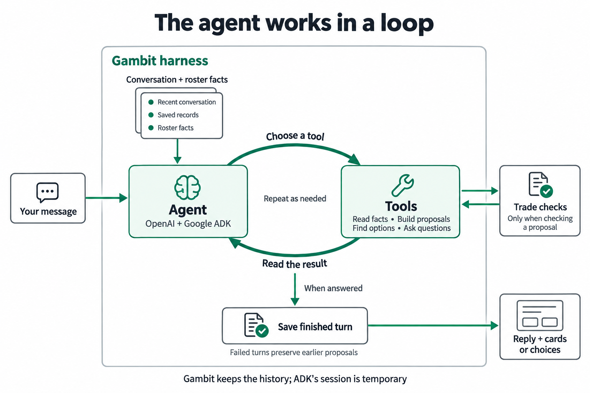

# Gambit

A conversational workspace for exploring NBA trades and roster scenarios. Describe a deal, inspect the players and picks, check the proposed package, and revise it without losing earlier versions.

Gambit combines chat with player research, a draft-pick browser, structured trade cards and saved proposals.

The application source is in `trade-builder/`.

## Live demo

[Open Gambit](https://gambit-demo.stuartrobinson3007.workers.dev). Access uses the shared demo password.

## What you can do

- **Check a trade.** Describe who moves where across two to four teams. Gambit builds a card showing the assets, salaries and validation result.
- **Find trade ideas.** Specify a team, player or constraint, browse matching two-team packages, and select up to five to check.
- **Research players and picks.** Search rosters, inspect contracts, compare up to four players, and filter picks by ownership, origin, year and round.
- **Explore roster scenarios.** Try different contracts, free-agent signings, sign-and-trades, trade exceptions or stretch-and-waive assumptions.
- **Keep alternatives.** Reopen earlier versions, revise them independently, and bookmark proposals in Saved trades.

## Things to try

- **Misspell a player's name.** Gambit resolves a minor typo when there is one clear match, or asks you to choose when the identity is uncertain.
- **Use only a surname.** If several players match, it asks which one and keeps the rest of your request ready to continue.
- **Correct yourself while answering a question.** It reconciles your correction with the selected answer before continuing, preserving the parts of the request you did not change.
- **Refer to an earlier option after discussing other deals.** It retrieves the original result set and its ordering to identify the proposal you mean.
- **Find a replacement with different age, position or salary constraints.** It searches the outgoing player's team while keeping the other assets fixed.
- **Ask for more results or refine a search.** It retains the search scope; continuing excludes packages already shown, while new filters create a revised search.
- **Change several parts of a trade at once.** It applies the edits together, preserves unaffected transfers and checks one new version.
- **Undo an edit after exploring another trade.** It returns to that proposal's parent version.
- **Try a hypothetical salary, then explore a separate deal.** The assumption follows revisions of its own scenario; the separate deal uses the original contract.
- **Ask why an earlier version failed.** It explains the checks recorded for that exact proposal.

## Run locally

Use Node.js 24 or later and npm. The server uses built-in Node SQLite, and the scripts import TypeScript directly.

```sh
cd trade-builder
npm install
```

Create `.env.local` in the `trade-builder` directory:

```dotenv
OPENAI_API_KEY=your_api_key
# Optional model override:
GAMBIT_EXECUTION_MODEL=gpt-6.1-sol
```

Then start the development server:

```sh
npm run dev
```

Open [localhost:3000](http://localhost:3000). Chat requires a configured OpenAI credential and network access to OpenAI and the bball-GM service. Missing credentials and service failures produce explicit errors.

Credentials stay server-side. `.env.local` is ignored by Git; do not prefix the API key with `VITE_`.

- `OPENAI_API_KEY`: Required for model-backed chat.
- `GAMBIT_EXECUTION_MODEL`: Optional; defaults to `gpt-6.1-sol`.
- `GAMBIT_CONVERSATION_DB`: Optional local SQLite path; defaults to `.gambit/conversations.sqlite`. Set it in the server process environment.

## Data and validation

Player identities, team ownership, contracts, picks, trade exceptions and cap context come from [bball-GM](https://bball-gm.com). Annual contract projections are marked as estimates.

The server checks identities, ownership and transfer completeness before submitting a proposal to the validator. Each verdict belongs to an exact immutable proposal version. An unavailable check is distinct from an invalid trade; salary checks do not establish basketball value or another team's willingness to accept a deal.

Current limits:

- Automatic discovery supports two teams and one to three players per side. Explicit trades support up to four teams. Search pages use bounded scans and expire after 30 minutes; Refresh search preserves the scope and starts a new version with current data.
- Existing pick protections are retained. Custom protections, conveyance schedules and swap rights are unsupported; swap picks are omitted from the research browser.
- Ordinary signings are checked separately from trades, even when linked to a trade version. Combined signing budgets and post-trade signing eligibility are not established.
- Sign-and-trades can report **Checks incomplete** when required historical or timing evidence is unavailable. Stretch-and-waive scenarios show payroll arithmetic rather than complete CBA compliance.

## How the agent works

The **harness** is the server code around the model. It supplies conversation history and roster facts, gives the model tools to use, checks the results and saves the finished work.

OpenAI provides the model that understands the request and chooses what to do next. Google ADK manages the back-and-forth between that model and Gambit's tools. Gambit's own code builds proposals, runs searches, checks trade rules and stores the conversation.



### From a message to a result

1. **Load the conversation.** The server checks the incoming message and selected assets, then loads roster data and the saved conversation. A repeated request can reuse its saved reply. Version checks prevent a message from silently overwriting newer work.
2. **Give the agent context.** The model receives recent messages, a player/team directory and summaries of saved proposals, searches and questions. Tools can retrieve older records or more detail when needed.
3. **Let it work through the request.** The agent chooses a tool, reads its result and decides what to do next. It can look up a player, inspect an earlier deal, find alternatives or ask for missing information. The same loop handles understanding and execution, so new evidence can change its next step.
4. **Check proposals when needed.** Tools turn the requested changes into a complete proposal. Code checks identities, ownership and destinations, then requests the applicable trade or signing checks. Research and browsing ideas do not require a trade check.
5. **Save and reply.** A completed turn saves its new records and response together. The browser renders the returned text, proposal cards or question choices.

### Example request flow

For a new Derrick White / Andrew Wiggins exchange, the harness prepares the context before the model calls `search_players`, `check_proposal` and `finish_response`. Each result informs the next call. The harness saves the completed turn before the browser displays the explanation and trade card.


### Remembering which deal you mean

The conversation stores more than message text:

- **Proposal versions** keep the exact assets, assumptions and checks, plus the version an edit came from.
- **Search versions** keep the requested scope, filters and fixed assets.
- **Result batches** keep the order in which options were shown.
- **Questions** keep the unfinished request and the information still needed.
- **Execution records** keep what tools actually tried and what happened.

The agent uses those records to identify the deal or search you are referring to. An edit names the exact version it changes; undo follows that version's parent. Earlier proposals remain available after other deals have been discussed.

ADK creates a temporary session for each request. Gambit's database holds the lasting history. Keeping recent model context small does not delete older conversation records; the agent can retrieve them through tools.

### Keeping changes consistent

Tools accept structured inputs with defined fields and types. Gambit also checks that referenced records belong to this conversation and that requested assets and routes are valid. A correctly shaped tool call still needs these domain checks.

Work happens on a private copy of the conversation until the turn completes. Several requested edits can become one checked version. If the model or a required service fails, staged proposal and search changes are discarded, while the failure details are retained. A trade that fails the rules is a completed check with an invalid result; a service failure means the check was unavailable.

Conversation locks and database version checks keep competing requests from replacing each other's work. Validation evidence is tied to the exact proposal version and roster data used for its check.

### Progress and direct actions

`/api/trade-chat` sends tool progress to the browser over server-sent events (SSE). The final text and cards arrive with the completed result. The agent loop has a model-call limit and a request deadline; Effect manages timeouts, cancellation and service lifetimes.

Some actions already have an exact meaning. Selecting trade ideas without extra instructions checks those packages directly, and cancelling a question updates its status directly. Neither needs another model call.

### Main harness files

- `src/server/trade-harness.ts`: Coordinates a request, checks retries and versions, and chooses the agent or direct action path.
- `src/server/adk-trade-agent.ts`: Runs the model/tool loop and publishes tool activity.
- `src/server/openai-adk-model.ts`: Connects ADK to the official OpenAI SDK and carries tool results into the next model call.
- `src/server/conversation-turn.ts`: Defines the tools, stages changes and completes or discards the turn's work.
- `src/server/conversation-instructions.ts`, `src/server/conversation-read-tools.ts`: Supply instructions and access to roster facts and saved records.
- `src/server/trade-api.ts`: Loads catalogue data and connects proposal checks to the trade service.

## Stack and storage

The app uses React, TypeScript and TanStack Start with Vite. Tailwind, shadcn/Base UI and Hugeicons provide the interface; Lexical handles editable asset references.

- `src/components/workspace/`: Chat, composer, research panels and proposal cards.
- `src/components/ui/`, `src/components/ai-elements/`: Shared interface components.
- `src/lib/trade/`: Proposal types, financial calculations and asset rules.
- `src/server/`: Agent tools, validation adapters and conversation storage.
- `src/routes/`: Application, chat endpoint and local review routes.
- `scripts/`, `tools/ux-review/`: Integration checks, recording tools and visual review support.
- `docs/`: Feature details, deployment instructions and historical evidence.

Local conversations, proposal versions, searches, questions and execution records persist in `.gambit/conversations.sqlite` across reloads and server restarts. Browser storage holds a display cache and bookmarks. Bookmarks do not sync between devices, and unsent composer drafts are ephemeral.

Cloudflare mode stores each authenticated browser's conversation history in its own SQLite-backed Durable Object. The shared-password deployment has usage limits and does not upload the local database. See [Cloudflare deployment](trade-builder/docs/cloudflare-deployment.md) for credentials, sessions, local Worker development and release commands.

## Checks and recorded previews

Run the checks relevant to your change from `trade-builder/`:

```sh
npm run typecheck
npm run lint
npm run build
npm test
```

`npm test` runs local integration checks with injected service responses and live network requests disabled. It uses no model credits. Prefer meaningful browser journeys for UI changes and focused integration checks for storage, transport and deployment boundaries. See [testing guidance](trade-builder/docs/testing.md).

To inspect existing conversations with the current UI:

```sh
npm run review:chat
```

Open [the UX reviewer](http://127.0.0.1:3018/ux-review). For a simpler conversation presentation, run `npm run present:chat` and open [chat presentation](http://127.0.0.1:3020/chat-presentation). Browsing either viewer does not call the model. Recordings retain their original outcomes and may predate the current backend.

Live chat checks and recording refreshes consume model usage. Run them only when live verification is intended, and filter to the relevant scenario:

```sh
npm run test:chat:live -- /tmp/gambit-chat-flows.json "scenario name"
```

## Further reading

- [Conversation records and persistence](trade-builder/docs/conversation-memory.md)
- [Trade ideas, paging and selection](trade-builder/docs/trade-ideas.md)
- [Multi-team trades](trade-builder/docs/multi-team-trades.md)
- [Draft-pick browser](trade-builder/docs/draft-pick-browser.md) and [pick validation](trade-builder/docs/draft-picks.md)
- [Contracts, signings, exceptions and payroll scenarios](trade-builder/docs/trade-machine.md)
- [ADK integration and browser streaming contract](trade-builder/docs/ai-sdk-to-adk-migration.md)
- [Recorded UX review](trade-builder/docs/chat-ux-review.md)
- [Product intent](trade-builder/PRODUCT.md) and [domain terminology](trade-builder/CONTEXT.md)

The original assignment and learning materials remain available in [ONBOARDING.md](ONBOARDING.md).
