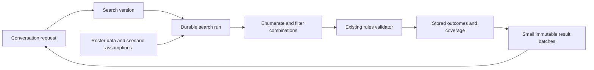

> Historical investigation. Superseded by [trade idea selection](../trade-ideas.md).

# Exhaustive search: investigation and proposed direction

Investigated 9 October 2026. The implementation of the supported-scope runner is now documented in [exhaustive-search-implementation.md](exhaustive-search-implementation.md). The findings below describe the earlier implementation and the proposed direction. The live probe used the existing rules adapter, without model calls or changes to conversations. Evidence is in [exhaustive-search-probe.json](evidence/exhaustive-search-probe.json).

## What the live experiment establishes

For the screenshot's Bulls request—one player for one player, incoming salary at most $12 million, savings of at least $5 million, payroll after the trade at most $142 million—the current eligibility rules produce 6,735 pairs. Applying the three financial filters leaves 160 candidates. Those candidates involve Nic Claxton or Josh Giddey going out.

I checked every candidate using `evaluateProposal`, with three concurrent requests. All 160 received `invalid_trade`, none were unavailable, and the validation phase took 17,253 ms. Individual checks ranged from 264 to 773 ms, with a median of 315 ms. This is one observed run, not a latency guarantee or a service capacity agreement. Interpretation and writing a response were outside that timing.

The example can therefore finish its defined search today, using the existing remote engine. It does not require a constraint solver or a new rules implementation. Its existing limited response could not establish the negative result even though that result happens to be correct.

The experiment covers the adapter's supported eligible players and current service evidence. It does not establish universal NBA legality or an atomic upstream dataset snapshot.

## Findings in the current implementation

| Area | Current behaviour | Consequence for a larger search |
| --- | --- | --- |
| Discovery | `trade-discovery.ts` limits generation to 50,000 examined combinations or 250 ms, keeps 18 candidates per partner, checks at most 18 overall, and stops after three passing options. | Removing only the validation cap leaves incomplete generation and early stopping. |
| Repair and replacement | `trade-repair.ts` generates candidates using a different policy and also checks at most 18, stopping after three results. | Coverage has different meanings in different tools. A repair currently changes one slot or adds one player per candidate, rather than exploring every possible repair. |
| More options | `executeSearch` reruns the engine and excludes packages previously shown. | Failed checks are repeated; pagination and search execution are conflated. |
| Conversation lifecycle | Search runs inside the staged chat transaction and conversation lock, under a 90-second turn timeout. The HTTP request's abort signal reaches that work. | Long searches block follow-ups and cannot be relied on to survive a disconnected request or process restart. |
| Persistence | Conversation state, candidates, history and replies are serialized into one SQL row. | Bulk results must not be added to that blob. The recorded candidate snapshots average about 1,887 bytes each; 1,000 already approach 1.9 MB before conversation overhead and duplication. |
| Identity | `tradePackageKey` contains teams and transfers only. | Suitable for the existing package exclusions, but insufficient for validation caching across salaries, exceptions, signings or datasets. |
| Hypothetical payroll | Repair uses scenario-adjusted player salaries but passes the catalogue team to `matchesSalaryConstraints`, which uses its ordinary payroll. | A hypothetical repair can be incorrectly filtered before validation. The common search context must calculate the correct baseline. |
| Validation completeness | Discovery accepts fully valid verdicts; repair can also return `validation_incomplete`. | Search completion and completeness of rule evidence must be separate. Finishing enumeration does not resolve missing signing evidence. |
| Presentation | Search batches have saved identities and order, and historical references depend on them. | New results must not reorder previously shown options. Background completion must not replace the current discussion or hide a pending question. |
| Usage limits | The deployed guard limits chat turns and browser requests. | It does not constrain aggregate validation traffic across background searches. |

Relevant files: `src/server/trade-discovery.ts`, `trade-repair.ts`, `conversation-search.ts`, `conversation-records.ts`, `conversation-turn.ts`, `trade-harness.ts`, `conversation-sql.ts`, `src/cloudflare.ts`, and `src/components/workspace/use-trade-workspace.ts`.

## Recommended model

Keep the existing search versions and proposal versions. Add a distinct execution record for each search run, with durable progress and result storage. A search version expresses what is wanted; a run records the data and evidence used to investigate it; a result batch records exactly what the user saw.

Use one common runner for enumeration, validation, retries, checkpointing and coverage. Candidate generation can remain specific to discovery, replacement or repair. A single large function with every trade shape would make the system harder to maintain.

The run must retain the exact search specification, referenced proposal version, roster fingerprint, scenario assumptions, candidate traversal position, validation outcomes, unresolved checks and lifecycle state. Changes to age limits, destinations, players or assumptions create a new search version; they do not mutate an older run's scope.

### Coverage is evidence, not a percentage alone

Account separately for combinations examined, combinations safely excluded by known constraints, candidates validated, candidates awaiting checks, and checks that could not be resolved. A timed-out or cancelled run retains useful results but cannot establish that none exist. Unknown player facts and unsupported asset classes must not disappear behind a confident completion claim.

Generation can skip entire salary ranges when arithmetic proves they fail a requested constraint. It cannot eliminate a package just because salaries differ, a team already has enough displayed options, or an LLM thinks the deal unlikely. Fairness or fit can affect ranking after qualification; they cannot support a proof of no rules-compatible option.

Start with direct enumeration and sorted package salary indexes. Reserve a constraint solver for a later measured need. A solver only establishes conclusions for its encoded constraints, not rules hidden inside the external service. [OR-Tools distinguishes feasible, proven infeasible and unknown outcomes](https://developers.google.com/optimization/cp/cp_solver).

### The conversation remains available

Commit the search intent and a scheduling entry atomically at the end of the accepted chat turn. A worker starts only committed work, using a stable run ID, so a model failure cannot leave an unreferenced search running and a retry cannot create a duplicate. Claim and persist each bounded work slice separately from the conversation transaction.

Progress updates use their own cursor rather than incrementing the conversation's semantic version for every check. The UI subscribes to or polls the original search; it can reconnect after reload. Background updates must not become unsolicited new assistant turns, steal scroll position, change discussion references, or replace the latest pending-question message.

If the user asks about payroll while a search runs, answer normally and let it continue. If they refine that search, create a new version and stop obsolete work where appropriate while retaining its evidence. An explicit request to stop cancels work, without removing historical cards. Returning to an earlier batch resolves that batch's exact search and proposal versions.

Freeze the order and identity of every displayed batch. “The middle option” must continue to mean the same proposal. “Show more” retrieves additional unseen results; reranking does not rewrite old batches. Provisional results can appear before completion, but they cannot be called the best overall results without supporting evidence.

Only shown proposals and concise run summaries enter the model context and ordinary conversation payload. The complete result pool stays in indexed server-side tables and can be retrieved in pages. Viewing options does not silently apply any of them.

### Rules, data and scenarios

Retain the existing validation adapter as the authority for checks. Normalize cache identities from transfers, effective salaries, contract assumptions, signings, funding routes, selected exceptions, roster facts and rule version where available. Rebind cached evidence to the actual proposal version only after those inputs match. Never cache an unavailable check as an illegal trade.

A local catalogue fingerprint identifies our facts, but the upstream service currently offers no demonstrated snapshot token for pinning its checks to those facts. Evidence mismatches must remain unresolved; longer runs need explicit refresh/restart handling. A reusable versioned engine or a batch endpoint accepting a dataset version would improve both speed and correctness. Neither is available in this workspace today.

Hypothetical searches need a resolved scenario view: effective salaries, payrolls, ownership, eligibility and prior proposal assumptions. Derive filters and validation from that same view. Ordinary unrelated alternatives continue to use actual catalogue ownership, rather than assuming an earlier hypothetical transfer happened.

Preserve the existing distinction between a trade, an ordinary signing linked to it, and a genuine sign-and-trade. A full trade search cannot establish signing eligibility after that trade if the validator lacks the necessary combined evidence. Searching signings also requires explicit finite contract choices or ranges; do not silently choose arbitrary salaries or durations to make a result pass.

Picks and draft rights can initially stay fixed in replacement and repair searches. Automatic enumeration of those assets needs a separately declared finite scope. Three/four-team searches additionally need defined destination choices, participant limits and fixed routes. Multiple simultaneous replacement slots are a new search capability, not a larger limit on today's one-slot replacement engine.

## Infrastructure choice

The first implementation should reuse SQLite and Cloudflare Durable Objects. Store search runs and candidate outcomes in separate rows, with atomic checkpoints. A search-specific Durable Object can own a run, execute bounded slices and schedule further slices through alarms; a local worker can run the same engine against SQLite. Keep platform scheduling out of the search algorithm.

This is a narrower fit than introducing Workflows immediately: the core operation is a repeated, checkpointed candidate scan, and Durable Objects are already part of this deployment. Alarms survive idle periods and execute at least once, so candidate writes and scheduling must be idempotent. Retry exhaustion also needs explicit persisted state, rather than an indefinitely stalled “searching” label. [Cloudflare alarms documentation](https://developers.cloudflare.com/durable-objects/api/alarms/).

Workflows remain a good alternative for later multi-stage orchestration. They do not eliminate the need for candidate storage, exact coverage, cancellation or idempotent effects. [Cloudflare's workflow guidance](https://developers.cloudflare.com/workflows/build/rules-of-workflows/) describes granular retryable steps and durable state requirements.

Current Cloudflare limits include six outgoing connections per invocation and a 2 MB SQL row/string limit. Use modest concurrency, a shared validation traffic budget across jobs, backoff for service failures and bounded retention. Chat-turn quotas are not a substitute for a search-work budget. A paused run keeps its traversal position and coverage; reaching a cost or time budget does not make its search complete. [Durable Object limits](https://developers.cloudflare.com/durable-objects/platform/limits/).

## Proposed user-facing behaviour

Small searches try to complete promptly using the same durable runner. Larger ones show available options and continue without keeping the composer disabled. Status belongs to the search that produced those options.

Possible messages, conditional on real evidence:

- Complete Bulls example: “None of the 160 options meeting your limits passed salary and roster checks.”
- Results while work continues: “Here are three options. I’m still checking the rest.”
- Unresolved checks: “These options passed. I couldn’t finish checking every option.”

Put counts, scope and blocking-rule details in the existing expandable work history when helpful. Do not introduce “Needs review”, a “Check trade” button, job terminology, a mandatory “Continue” workflow, or generic technical disclaimers. Completed work uses the existing duration treatment; work still running must not be presented as finished merely because its first page was delivered.

## Implementation sequence and acceptance

1. Define coverage and exact run identities; extract common scenario-aware candidate filtering and validation handling. Preserve currently supported scope explicitly.
2. Add durable run/result tables and a shared bounded runner. Implement full small two-team searches and true pagination, including the Bulls example. Start with conservative remote concurrency.
3. Connect committed scheduling, progress/reconnect, cancellation, follow-up messages and immutable batches. Add deployment-wide validation budgets and retries.
4. Integrate replacement and repair generation, then add explicitly scoped multi-team and additional asset capabilities. Seek an upstream batch/versioned engine before promising fast broad combinatorial searches.

Verify through live backend exercises and browser E2E, without adding unit tests. Extend the atlas with first success after the former 18-check boundary, candidates beyond the former generation boundary, a completed zero-match search, unresolved checks, retry without duplicates, reload mid-search, research while running, refinement while running, cancellation, selecting an early option, more results after completion, historical middle-option references, hypothetical payroll changes, signing limits, and several concurrent users/jobs. Capture progress, partial results and completion as separate checkpoints. A successful screenshot capture is not evidence that the search covered its scope.

No production search code, model prompts or current atlas conversations were changed during this investigation.
