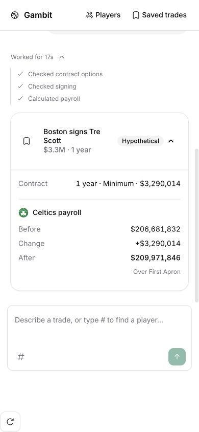
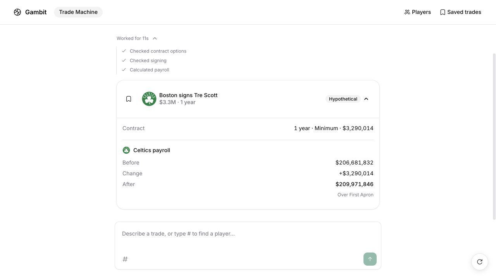

# Signing copy and retry verification

The single-signing card no longer includes the `Validation scope` disclosure or its generic backend paragraph. Multiple signings, or a signing combined with contract overrides, retain a concise warning that combined eligibility has not been checked.

The recorded signing frame was opened in the browser, including its completed work history. Recovered signing failures were absent; the three visible entries were `Checked contract options`, `Checked signing`, and `Calculated payroll`. Desktop and 390 × 844 mobile layouts were inspected.

A fresh live chat on an isolated server submitted `Sign Tre Scott to Boston on a one-year minimum contract.` The result completed in 11 seconds, with a one-year $3,290,014 signing and Boston payroll $209,971,846. The stored raw activity history contained no failed calls: the team was selected, current contract options fetched, and the signing checked in that order. Session: `18fd67ec-b017-4295-bea5-534fe7e46a7e`.

Raw activity records remain intact. New signing retry metadata distinguishes player, team and action; unresolved failures, later failures, and failures for different players or teams remain visible. Older recordings use their known signing stage labels to summarize recovered retries.

Six focused activity tests, typecheck, targeted lint, and production build passed. The design detector reported no findings for the edited UI files. The build emitted existing configuration and chunk-size warnings.

