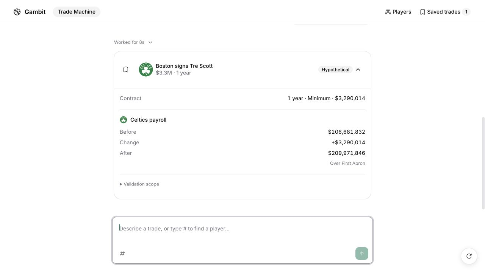
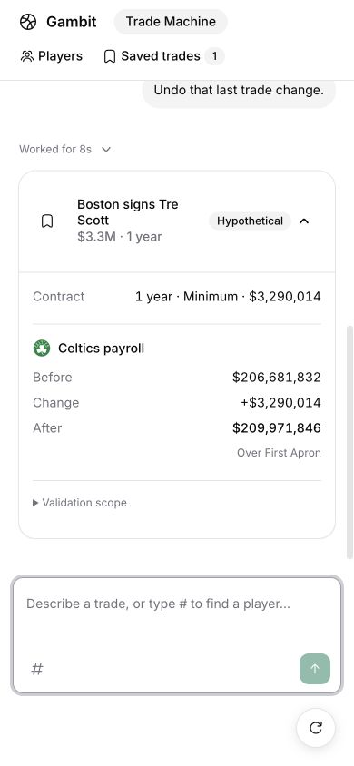

# Signing flow UX verification

Verified the recorded `signing-then-sign-and-trade` frames and actual chat on an isolated local server with the configured model and live validation services. No unit tests or mocked responses were used for this verification.

Live inputs:

1. `Hypothetically sign Tre Scott to Boston on a one-year minimum contract.`
2. `Now sign-and-trade Tre Scott to Miami.`
3. `Undo that last trade change.`

The signing displayed a one-year minimum contract at $3,290,014, with Boston payroll $206,681,832 before, +$3,290,014 change, and $209,971,846 after. The card had no empty trade columns or $0 salary-matching rows. Validation scope opened using the keyboard.

Saving showed the same contract and payroll in the saved panel. The next turn displayed `Tre Scott to Miami`, sign-and-trade terms, and the validator's Miami salary-matching and first-apron failures. Undo restored the signing without transferring Scott. Reload preserved the restored proposal and original saved signing. Response durations were 16, 13 and 8 seconds.

Desktop and mobile layouts were inspected. Typecheck, targeted lint and production build passed. Build emitted existing configuration and chunk-size warnings.

