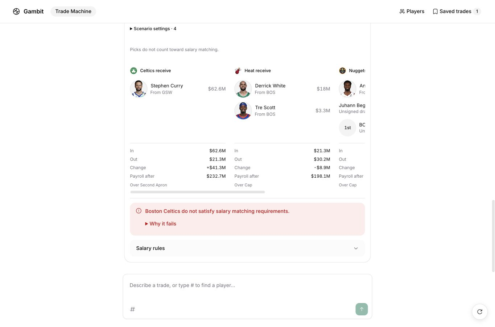
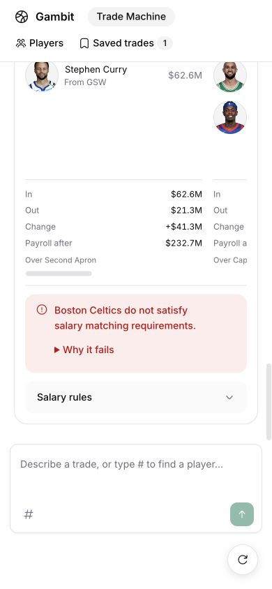

# Trade-machine browser E2E — 8 October 2026

The original four-message complex scenario now completes in a fresh UI chat without clarification. The run used the configured chat model and live trade validator, with an isolated conversation database on port 3047. Browser actions submitted every message; persisted results from those same requests were inspected to verify exact assets, routes and settings.

| Browser flow | Observed result |
| --- | --- |
| Four-team package | White → Miami, Wiggins → Denver, Jokic → Golden State, Curry → Boston; Boston's own 2031 first → Miami; Boston-owned protected Charlotte 2030 second → Golden State; Begarin's unsigned rights → Denver |
| Contract and exception edit | White: $18m/year, two years; Simons exception selected; all seven original assets retained |
| Combined minimum signing and sign-and-trade | Tre Scott signed hypothetically to Boston at $3,290,014 for one year, then sent to Miami; original assets and settings retained |
| Stretch and waive | Hauser obligation: $4,649,235 annually for seven years; no Hauser transfer; all eight trade assets retained |
| Save and reload | Complete scenario and saved version survive reload |
| Undo | Only Hauser's last stretch setting removed; all other assets, signing, salary override and exception retained |
| Pick reroute | Boston's 2031 first moved from Miami to Denver; every other asset and setting unchanged |
| Progressive details | Space opens/closes scenario settings; failure details and team salary rules remain accessible |
| Mobile | No page-level horizontal overflow at 390px; team region scrolls horizontally to remaining teams |
| Removed downloads | No share-card/recap controls; both former export formats return 404 |

The final scenario is correctly displayed as invalid by the connected validator: Boston fails salary matching and cannot use the selected TPE above the relevant hard cap. Resulting payroll: Boston $232,722,010; Miami $198,056,326; Denver $198,919,279; Golden State $213,936,368. These runs verify application behavior and the connected validator's returned evidence; they do not independently audit the validator's rulebook.

The initial runs uncovered and fixed lost pick ownership, pick labels interpreted as player names, repeated rejection of reconstructed pick queries, premature unsupported responses for unsigned free agents, unnecessary clarification when retaining an existing exception, and pick reroutes using player tools. The UI now exposes resulting payroll directly and collapses scenario settings and detailed failures. Verified exception source names survive in saved scenario notes.

Remaining friction observed: the four original turns took 21, 14, 18 and 10 seconds; rerouting took 34 seconds. Four-team results require horizontal scrolling on desktop as well as mobile. Generic exception-choice previews can still add the source player's current club as irrelevant context; the unnecessary exception question in this scenario was eliminated.

Typecheck, lint and production build passed. The Impeccable detector reported only existing 11px/13px typography advisories. Browser console inspection returned no warnings or errors.

[Recorded proposals, verdicts and state checks](trade-machine-e2e-2026-10-08.json)

