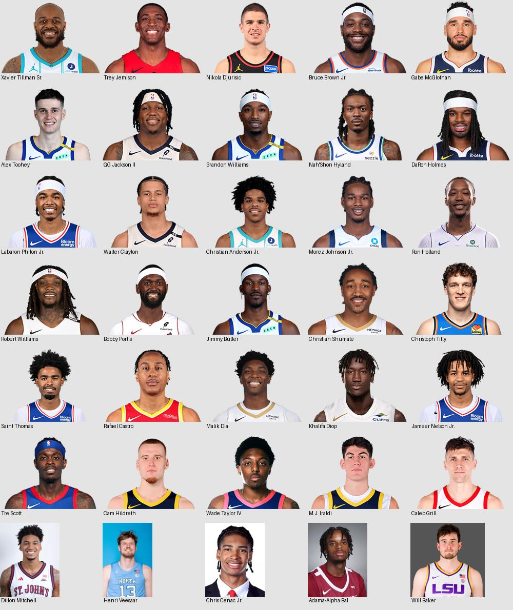

# Local player headshots

Acquired and verified on 7 October 2026 for the synthetic Gambit 2026–27 demo catalogue.

| Coverage stage | Catalogue entries |
| --- | ---: |
| Roster size | 629 |
| Unique normalized static NBA directory name matches | 597 |
| Usable portraits in that initial batch | 594 |
| Initial generic silhouettes rejected | 3 |
| Additional entries recovered through investigation | 35 |
| Final usable local portraits | **629 / 629 (100%)** |
| Unresolved entries | **0** |

Final sources: 619 NBA CDN portraits, five NBA G League portraits, and five official college roster portraits. Counts refer to internal catalogue entries. The snapshot contains repeated real players under different internal IDs; all 629 IDs are mapped, representing 623 distinct portrait checksums. The catalogue itself was left unchanged.

## Use in the UI

```tsx
import { getPlayerPhoto } from '@/lib/trade/player-photos'

const photo = getPlayerPhoto(player.id)

```

`getPlayerPhotoUrl(id)` returns a local path directly. `getPlayerPhoto(id)` also returns `hasPhoto` and an avatar crop position. Unknown IDs use `/player-headshots/fallback.svg`; generic silhouettes are never counted as coverage. For an image load failure, the UI may also use `PLAYER_PHOTO_FALLBACK_URL`. No UI components or Player model fields were edited by this task.

- Assets: `public/player-headshots/`.
- Runtime ID-to-URL index: `src/lib/trade/player-photo-urls.json` (small, bundled).
- Helper: `src/lib/trade/player-photos.ts`.
- Full provenance: `public/player-headshots/manifest.json` (served separately, not imported into the UI bundle).
- Verification/restoration: `scripts/player-headshots.py`.

Most images retain the official 260×190 PNG, including transparency. Three college sources provide small WebP portraits; Santa Clara and LSU provide JPEG portraits. Assets total 10,572,197 bytes (10.08 MiB), median approximately 16 KiB. The largest is the original LSU Will Baker portrait at 605,303 bytes; no build-time or runtime image service is needed.

## Investigation and identity decisions

Names were normalized using Unicode decomposition and removal of punctuation/spacing against [nba_api’s static directory](https://raw.githubusercontent.com/swar/nba_api/master/src/nba_api/stats/library/data.py). The remote Python source was parsed with `ast.literal_eval`, never executed. Its retrieved checksum is in the manifest. Matching a name only identified a candidate NBA ID; every downloaded image was subsequently decoded and checked.

The 32 initially unmatched/ambiguous entries and three rejected initial silhouettes were all investigated. Each recovered entry below has its own source URL, page, file dimensions, checksum, and acquisition date in the manifest. Synthetic team affiliation was not used as identity proof.

| Internal ID | Catalogue name | Final source | Resolution |
| --- | --- | --- | --- |
| 17023 | Tre Scott | [GLEAGUE](https://gleague.nba.com/player/1630286) (1630286) | Tre Scott / Trevon Scott; Cincinnati forward, born 1996. NBA latest silhouette; G League real portrait. |
| 17039 | Xavier Tillman Sr. | [NBA](https://www.nba.com/player/1630214) (1630214) | Xavier Tillman; suffix variant |
| 17589 | Christian Shumate | [NBA](https://www.nba.com/player/1643104) (1643104) | G League profile adds ID; NBA endpoint has a real portrait |
| 17482 | Trey Jemison | [NBA](https://www.nba.com/player/1641998) (1641998) | Trey Jemison III; suffix variant |
| 17590 | Christoph Tilly | [NBA](https://www.nba.com/player/1643754) (1643754) | NBA official player page adds ID absent from static directory |
| 17591 | Will Baker | [COLLEGE](https://lsusports.net/sports/mb/roster/player/will-baker) | LSU 2023-24 center Will Baker; college roster and G League transaction establish identity. No static NBA directory match. |
| 17595 | Cam Hildreth | [GLEAGUE](https://gleague.nba.com/player/1643160) (1643160) | Cam / Cameron Hildreth; Wake Forest guard, NBA latest silhouette; official G League portrait used. |
| 17593 | Wade Taylor IV | [GLEAGUE](https://gleague.nba.com/player/1642965) (1642965) | NBA latest returned a generic silhouette; official G League portrait used. |
| 17594 | M.J. Iraldi | [GLEAGUE](https://gleague.nba.com/player/1643161) (1643161) | NBA latest returned a generic silhouette; official G League portrait used. |
| 17592 | Caleb Grill | [GLEAGUE](https://gleague.nba.com/player/1642934) (1642934) | NBA latest returned a generic silhouette; official G League portrait used. |
| 16988 | Nikola Djurisic | [NBA](https://www.nba.com/player/1642365) (1642365) | Nikola Djurisic / Nikola Đurišić; 2024 pick 43, Mega Basket, born 2004. Plain ASCII name requires explicit transliteration of Đ. |
| 17597 | Bruce Brown Jr. | [NBA](https://www.nba.com/player/1628971) (1628971) | Bruce Brown; suffix variant (also a separate existing Bruce Brown catalogue entry) |
| 17215 | Adama-Alpha Bal | [COLLEGE](https://santaclarabroncos.com/sports/mens-basketball/roster/adama-alpha-bal/8787) | Adama-Alpha / Adama Bal; Santa Clara profile verifies full name. NBA and G League endpoints returned silhouettes; college headshot used. |
| 17165 | Gabe McGlothan | [NBA](https://www.nba.com/player/1642440) (1642440) | NBA official player page adds ID absent from static directory |
| 17526 | Alex Toohey | [NBA](https://www.nba.com/player/1642893) (1642893) | NBA official player page adds ID absent from static directory |
| 17533 | Saint Thomas | [NBA](https://www.nba.com/player/1643148) (1643148) | G League profile adds ID; NBA endpoint has a real portrait |
| 17543 | Rafael Castro | [NBA](https://www.nba.com/player/1643572) (1643572) | NBA official player page adds ID absent from static directory |
| 17566 | Dillon Mitchell | [COLLEGE](https://redstormsports.com/sports/mens-basketball/roster/dillon-mitchell/6029) | Official college roster identifies this player; NBA latest endpoint returned a generic silhouette. |
| 17559 | Malik Dia | [NBA](https://www.nba.com/player/1643738) (1643738) | NBA official player page adds ID absent from static directory |
| 17486 | Henri Veesaar | [COLLEGE](https://goheels.com/sports/mens-basketball/roster/henri-veesaar/27323) | Official college roster identifies this player; NBA latest endpoint returned a generic silhouette. |
| 17537 | Khalifa Diop | [NBA](https://www.nba.com/player/1631215) (1631215) | NBA official profile; 2022 pick 39, Senegal/Gran Canaria |
| 17534 | Jameer Nelson Jr. | [NBA](https://www.nba.com/player/1642392) (1642392) | G League profile; TCU guard born 2001, distinct from his father |
| 17212 | GG Jackson II | [NBA](https://www.nba.com/player/1641713) (1641713) | GG Jackson; suffix variant |
| 17084 | Brandon Williams | [NBA](https://www.nba.com/player/1630314) (1630314) | 1999-born Arizona point guard, NBA ID 1630314; age 27 in synthetic 2026-27 catalogue. Reject retired 1975-born Brandon Williams (1585). |
| 17454 | Nah'Shon Hyland | [NBA](https://www.nba.com/player/1630538) (1630538) | Nah’Shon / Bones Hyland nickname; official NBA profile URL also uses nah-shon-hyland. |
| 17487 | Chris Cenac Jr. | [COLLEGE](https://uhcougars.com/sports/mens-basketball/roster/chris-cenac-jr/9544) | Official college roster identifies this player; NBA latest endpoint returned a generic silhouette. |
| 17097 | DaRon Holmes | [NBA](https://www.nba.com/player/1641747) (1641747) | DaRon Holmes II; suffix variant |
| 17516 | Labaron Philon Jr. | [NBA](https://www.nba.com/player/1642889) (1642889) | Labaron Philon; suffix variant |
| 17209 | Walter Clayton | [NBA](https://www.nba.com/player/1642383) (1642383) | Walter Clayton Jr.; suffix variant |
| 17491 | Christian Anderson Jr. | [NBA](https://www.nba.com/player/1643515) (1643515) | Christian Anderson; suffix variant |
| 17495 | Morez Johnson Jr. | [NBA](https://www.nba.com/player/1643516) (1643516) | Morez Johnson; suffix variant |
| 17110 | Ron Holland | [NBA](https://www.nba.com/player/1641842) (1641842) | Ron / Ronald Holland II; age 21 and SF consistent with 2005-born player. |
| 17374 | Robert Williams | [NBA](https://www.nba.com/player/1629057) (1629057) | Robert Williams III; suffix variant |
| 17238 | Bobby Portis | [NBA](https://www.nba.com/player/1626171) (1626171) | Bobby Portis Jr.; suffix variant |
| 17123 | Jimmy Butler | [NBA](https://www.nba.com/player/202710) (202710) | Jimmy Butler III; suffix variant |



## Verification

- All 629 files decode successfully; their dimensions, byte lengths, and SHA-256 hashes agree with the manifest.
- Every catalogue ID and name agrees with the manifest; the runtime URL index exactly agrees with available manifest entries.
- Contact sheets for all 597 initial candidates were visually inspected, followed by all 35 recovered portraits. Three initial NBA silhouettes and six additional NBA silhouettes were rejected; G League also returned a silhouette for Adama Bal, so his college roster portrait was used.
- Duplicate checksums only remain for repeated catalogue records of the same real player. The known NBA generic silhouette checksum is explicitly rejected.
- Unknown-ID fallback is present. No unresolved players remain.

Offline verification (Python 3 with Pillow):

```sh
python3 scripts/player-headshots.py
python3 scripts/player-headshots.py --contact-sheets /tmp/gambit-headshot-review
```

Restore missing or corrupted assets from recorded HTTPS sources:

```sh
python3 scripts/player-headshots.py --download
```

The restore command uses system curl with TLS verification and accepts only the reviewed checksum. Because NBA `latest` URLs can change, a changed remote portrait requires review before replacing the curated asset. It does not silently update a face, accept a silhouette, or change a roster identity. The manifest pins the catalogue checksum so future roster changes require review too.

All portraits are existing photographs from the linked sources. Their original source ownership remains with those sources.

## Named asset portraits

Trade exceptions can name people absent from the trade roster. These rows use a separate portrait-only index, `src/lib/trade/named-player-photo-urls.json`, rather than inserting a player or inventing contract/ownership data. The initial extra identity is Chris Boucher (NBA person ID 1628449). His official 260 × 190 portrait was visually inspected on 12 October 2026. Source, dimensions, checksum and retrieval date live in `public/player-headshots/named-manifest.json`; original roster coverage remains 629 / 629.

Named monetary choices retain their label's name for portrait lookup when no current player or team matches. Unmapped names and image-load failures use the existing initials fallback, preserving the 48px avatar and row alignment. Player inspection remains available only for actual catalogue players. Existing choice text and interaction are unchanged.
